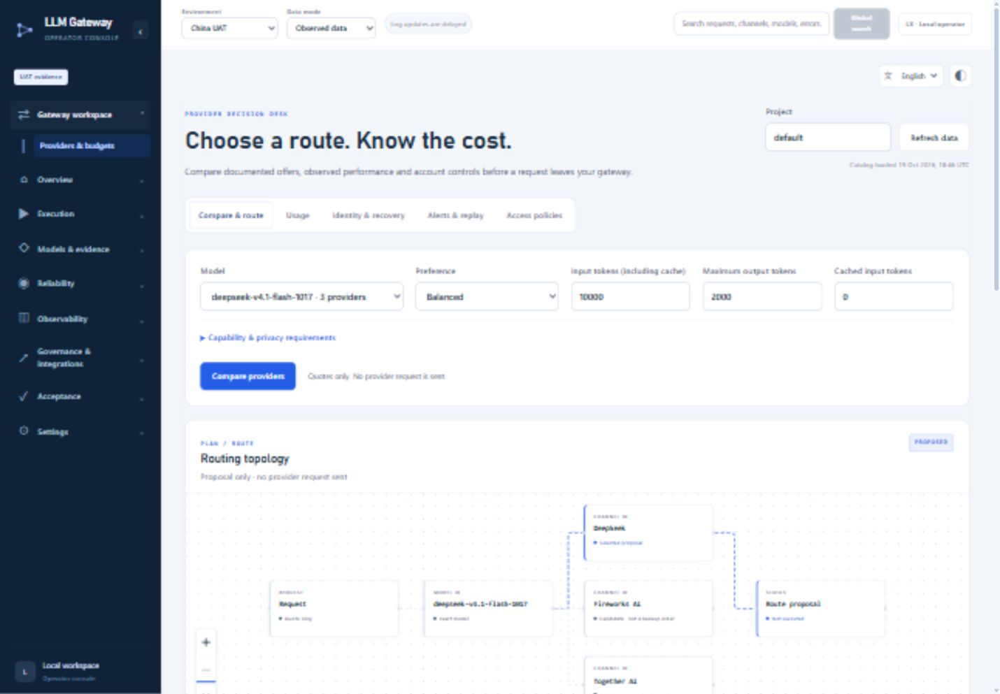

# Intelligent LLM Gateway

A provider decision workspace for language-model applications: compare documented model offers, estimate request costs, enforce project budgets, and inspect observed reliability before selecting a channel. The project also includes agent orchestration, controlled recovery, evaluation, and observability.

> Portfolio note: this repository demonstrates engineering architecture and deterministic offline workflows. Included metrics and fixtures are synthetic or sanitised unless explicitly labelled. It does not claim production benchmark performance, and real API execution is disabled by default.



## Why this project

LLM applications often need more than a single model call. They must select an appropriate model, choose a healthy delivery channel, recover safely from transient failures, explain routing decisions, and retain evidence for operational review. This project explores that full decision path as a testable software system.

## Key capabilities

- **Task and prompt analysis** — deterministic classification and complexity scoring before routing.
- **Capability- and cost-aware model selection** — configurable ranking across quality, cost, and latency preferences.
- **Published model offers** — source-linked model/channel mappings and token prices for six concrete models across eight offers from seven providers, with freshness checks and request cost estimates.
- **Gateway workspace** — provider comparison, itemised request estimates, project budget protection, model identity records, controlled fallback, usage analysis, in-app SLA alerts, historical repricing, and account capability/privacy controls at `/gateway`.
- **Unified operator experience** — responsive circuit-paper layouts, light/dark themes, English by default with Chinese and Japanese switching, and interactive routing topology with keyboard-accessible evidence panels and controlled trace replay.
- **Channel routing** — candidate resolution, confidence-aware selection, health-aware routing, and deterministic tie-breaking.
- **Multi-agent orchestration** — planning and offline execution for research, coding, reasoning, writing, and review roles.
- **Tool-aware agents** — a registry and controlled mock executors for calculation, code analysis, file analysis, and offline search.
- **Reliability controls** — retry policies, ordered fallback, execution guards, and complete attempt traces.
- **Evaluation and reflection** — rule-based output evaluation, reflection, and bounded self-correction loops.
- **Observability** — React/FastAPI operational console plus a multilingual Streamlit dashboard (English, Chinese, and Japanese).
- **Safety by default** — no credentials in source control, no network dependency for simulations, and explicit separation between mock, planned UAT, and measured evidence.

## Architecture

```text
User request
    |
    v
Task classifier + prompt complexity analyser
    |
    v
Capability / cost-aware model router
    |
    v
Model-channel resolver + health monitor
    |
    v
Routing strategy + execution guard
    |
    v
Agent runtime / tool execution / fallback
    |
    v
Evaluation + reflection + decision logging
    |
    v
React console / Streamlit dashboard
```

The routing, simulation, and agent modules use deterministic configuration files so decisions can be reproduced and tested without external model APIs.

## Technology stack

| Area | Technologies |
| --- | --- |
| Backend | Python, FastAPI, Pydantic, Uvicorn |
| Frontend | React 18, TypeScript, Vite, TanStack Query, Recharts, React Flow, Motion |
| Dashboard | Streamlit, Pandas |
| Testing | pytest, Vitest, Testing Library, Playwright |
| Storage | JSON/CSV fixtures and local SQLite runtime state |

## Run locally

### Prerequisites

- Python 3.11+
- Node.js 20+
- PowerShell 7 or Windows PowerShell

### Install

```powershell
python -m venv .venv
.venv\Scripts\Activate.ps1
python -m pip install -r requirements.txt

cd web
npm ci
npm run build
cd ..
```

### Start the local console

```powershell
powershell -ExecutionPolicy Bypass -File scripts/start-local.ps1 -OpenBrowser
```

The local console is served at `http://127.0.0.1:5174`. Open [the gateway workspace](http://127.0.0.1:5174/gateway) to compare providers, set budgets, and inspect usage, identities, recovery, alerts and access policies. See [Gateway workspace guide](docs/GATEWAY_WORKSPACE.md) for API endpoints, execution setup and evidence boundaries.

Comparison reads the documented catalog and existing local observations. It does not send a provider request. Optional execution requires server configuration, provider credentials, execution permission and explicit request confirmation; it is disabled by default. The current adapter supports non-streaming text requests. Unknown provider bills keep a conservative budget reservation until an evidenced settlement.

### Run the offline dashboard

```powershell
python -m pip install -r requirements-dashboard.txt
streamlit run dashboard/app.py
```

Use the language selector at the top of the home page to switch between English, Chinese, and Japanese.

### Compare documented provider offers

```powershell
python src/model_market_catalog.py --model deepseek-v4.1-flash-1017 --input-tokens 10000 --output-tokens 2000
```

This reads the local, provider-sourced catalog and returns three documented DeepSeek offers with token cost breakdowns. It does not send a model request. Prices were verified on 19 October 2026 and require reverification after seven days; measured reliability and latency remain unknown until observations exist. See [Model market catalog](docs/MODEL_MARKET_CATALOG.md) for sources, model identities, pricing conditions, and account setup boundaries.

## Tests

```powershell
python -m pytest tests -q

cd web
npm test
npm run build
```

The suite covers routing behaviour, safety boundaries, deterministic simulations, fallback traces, agent/tool execution, dashboard parsing, and UI components.

The gateway's focused checks are listed in [the workspace guide](docs/GATEWAY_WORKSPACE.md#verification). Some historical tests reference private raw evidence or experiment artefacts intentionally excluded from this public edition; those missing inputs are not replaced with fabricated fixtures. Focused passing checks do not imply that every historical test passes in a fresh public checkout.

## Operator interface

The shared language control switches the React console between English, 中文, and 日本語 without resetting request inputs or changing submitted model/strategy identifiers. The adjacent theme control switches between light and dark. Only these presentation preferences are stored in the browser; prompts, responses and credentials are not stored by the locale/theme layer.

At `/gateway`, compare providers to inspect a proposed route. Select nodes for evidence, pan or zoom the canvas, or use its text summary. The graph never edits routing decisions. Recorded attempts have a separate, explicitly labelled replay with play, pause and reset; it is not a live-traffic animation and cannot execute requests. Reduced-motion preferences disable playback. The Streamlit dashboard keeps its existing pages and language controls, with a matching theme.

See [the UI guide](docs/UI_REDESIGN_GUIDE.md) for presentation boundaries, verification results and known limitations.

## Repository boundaries

This public portfolio edition intentionally excludes credentials, browser sessions, local databases, raw UAT evidence, and runtime logs. Networked model calls are not required for comparison or analysis. The model cost catalog and model-channel mapping contain provider-published commercial offers, with sources and verification dates; they are local snapshots, not a live polling feed. Separate capability scores and synthetic experiment fixtures remain engineering heuristics or Mock data; they are not commercial benchmarks. Provider documentation does not establish account access, quota, live uptime, or successful execution. Reliability without sufficient real observations remains unknown. No live inference was performed to implement or validate the gateway workspace.

## Skills demonstrated

- Backend and API design
- React and TypeScript application development
- Reliability engineering and observability
- Deterministic simulation and statistical testing
- AI routing and agent orchestration
- Secure configuration and evidence-aware workflows

